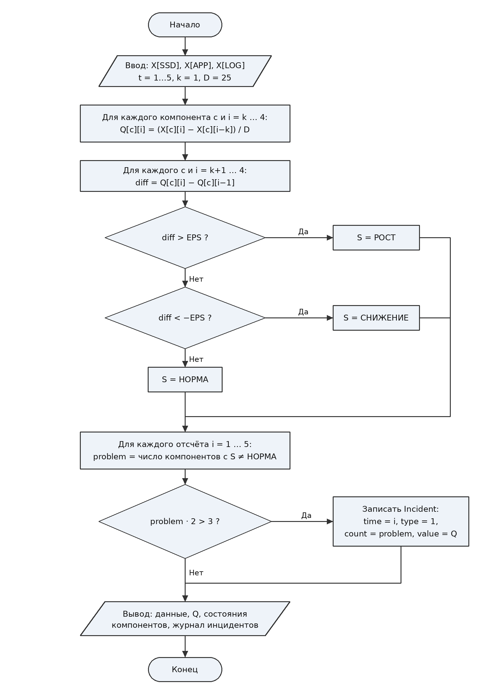

# Курсовой проект: Программа контроля облачной инфраструктуры

## Контрольная точка 1 (КТ1): Пять тестовых значений — формулы и базовый контроль

### Вариант 7

- **Компоненты:** `SSD`, `APP`, `LOG`
- **Порядок записи во входных данных:** формат `А` (`время компонент значение`), разделитель — запятая.
- **Тип последовательности (5):** во входных данных есть записи с неизвестными кодами компонентов (`UNK`); их нужно распознать и пропустить.
- **Телеметрия за пять отсчётов (одна строка):**
  ```text
  5,LOG,32.6,1,APP,57.4,2,UNK,72.0,2,APP,55.4,1,SSD,41.9,5,SSD,49.3,5,UNK,75.0,3,SSD,48.3,3,APP,53.4,4,APP,51.4,2,LOG,29.5,2,SSD,47.8,4,SSD,48.8,4,LOG,33.4,5,APP,54.8,1,LOG,30.2,3,LOG,34.1
  ```
- **Производный показатель $Q$:** нормированное изменение
  $$Q[i] = \frac{X[i] - X[i-k]}{D}$$
  Параметры: $k = 1$, $L = 2.0$, $D = 25$.
- **Правило состояния компонента (изменение направления):**
  - если $Q[i] > Q[i-1]$ — «РОСТ»;
  - если $Q[i] < Q[i-1]$ — «СНИЖЕНИЕ»;
  - иначе — «НОРМА».

  Состояния «РОСТ» и «СНИЖЕНИЕ» считаются проблемными. Параметр $L$ в этом правиле не участвует.
- **Правило инцидента (большинство):**
  Инцидент возникает, если большинство присутствующих компонентов находятся в проблемном состоянии. Присутствуют все три компонента, поэтому нужно не менее двух проблемных:
  $$\text{Incident}(t) = \left( \sum_{c \in \{SSD,\,APP,\,LOG\}} [S_c[t] \neq \text{НОРМА}] \right) \geq 2$$
  В виде логической формулы:
  $$\text{Incident}(t) = (P_{SSD} \land P_{APP}) \lor (P_{SSD} \land P_{LOG}) \lor (P_{APP} \land P_{LOG}),\quad P_c = (S_c[t] \neq \text{НОРМА})$$
- **Структура Incident:**
  ```c
  typedef struct {
      int time;
      int type;
      int count;
      float value;
  } Incident;
  ```
  Поля: номер отсчёта (`time`), тип инцидента (`type`, 1 — «большинство»), число проблемных компонентов (`count`), значение показателя (`value`).

  > Допущение: в `value` записывается значение $Q$ с наибольшим модулем среди проблемных компонентов на данном отсчёте.

---

## 1. Алгоритм и блок-схема

### Описание алгоритма

1. Задать массивы телеметрии для трёх компонентов (`SSD`, `APP`, `LOG`) на 5 отсчётов ($t = 1 \dots 5$). Записи `UNK` (отсчёты 2 и 5) отброшены.
2. Задать параметры: $k = 1$, $D = 25$.
3. Для каждого компонента вычислить $Q[i]$ для $i = 2 \dots 5$ (для $t = 1$ пары со сдвигом $k = 1$ нет).
4. Определить состояние компонента:
   - для $t = 1, 2$ данных недостаточно (нет $Q[i-1]$) $\rightarrow$ «НОРМА»;
   - для $t = 3 \dots 5$ сравнить $Q[i]$ с $Q[i-1]$: больше — «РОСТ», меньше — «СНИЖЕНИЕ», иначе «НОРМА».
5. Подсчитать проблемные компоненты на отсчёте. Если их больше половины от числа присутствующих (т.е. $\geq 2$), зафиксировать инцидент: номер отсчёта, тип, число проблемных компонентов, значение $Q$.
6. Вывести исходные данные, показатели $Q$, состояния компонентов и журнал инцидентов.

### Блок-схема алгоритма (КТ1)



---

## 2. Контрольный пример: ручной расчёт

### Исходные данные телеметрии (упорядочены по отсчётам)

| Отсчёт ($t$) | SSD ($X_1$) | APP ($X_2$) | LOG ($X_3$) |
| :---: | :---: | :---: | :---: |
| 1 | 41.9 | 57.4 | 30.2 |
| 2 | 47.8 | 55.4 | 29.5 |
| 3 | 48.3 | 53.4 | 34.1 |
| 4 | 48.8 | 51.4 | 33.4 |
| 5 | 49.3 | 54.8 | 32.6 |

### Ручной расчёт производного показателя $Q$ ($k = 1$, $D = 25$)

| Отсчёт | SSD | APP | LOG |
| :---: | :---: | :---: | :---: |
| $t = 2$ | $\frac{47.8 - 41.9}{25} = +0.236$ | $\frac{55.4 - 57.4}{25} = -0.080$ | $\frac{29.5 - 30.2}{25} = -0.028$ |
| $t = 3$ | $\frac{48.3 - 47.8}{25} = +0.020$ | $\frac{53.4 - 55.4}{25} = -0.080$ | $\frac{34.1 - 29.5}{25} = +0.184$ |
| $t = 4$ | $\frac{48.8 - 48.3}{25} = +0.020$ | $\frac{51.4 - 53.4}{25} = -0.080$ | $\frac{33.4 - 34.1}{25} = -0.028$ |
| $t = 5$ | $\frac{49.3 - 48.8}{25} = +0.020$ | $\frac{54.8 - 51.4}{25} = +0.136$ | $\frac{32.6 - 33.4}{25} = -0.032$ |

### Определение состояний и инцидентов

| Отсчёт ($t$) | Сравнение $Q[i]$ и $Q[i-1]$ (SSD / APP / LOG) | Статус SSD | Статус APP | Статус LOG | Проблемных | Инцидент |
| :---: | :---: | :---: | :---: | :---: | :---: | :---: |
| 1 | — | НОРМА | НОРМА | НОРМА | 0 | Нет |
| 2 | — | НОРМА | НОРМА | НОРМА | 0 | Нет |
| 3 | $0.020 < 0.236$ / $-0.080 = -0.080$ / $0.184 > -0.028$ | **СНИЖЕНИЕ** | НОРМА | **РОСТ** | 2 | **Да (тип 1, $Q = +0.184$)** |
| 4 | $0.020 = 0.020$ / $-0.080 = -0.080$ / $-0.028 < 0.184$ | НОРМА | НОРМА | **СНИЖЕНИЕ** | 1 | Нет |
| 5 | $0.020 = 0.020$ / $0.136 > -0.080$ / $-0.032 < -0.028$ | НОРМА | **РОСТ** | **СНИЖЕНИЕ** | 2 | **Да (тип 1, $Q = +0.136$)** |

Ожидаемый результат: инциденты возникают на отсчётах **3** (проблемные `SSD`, `LOG`) и **5** (проблемные `APP`, `LOG`), в обоих случаях с количеством проблемных компонентов **2**.

---

## 3. Реализация программы

Исходный код программы: [Source.c](Source.c)

Особенности реализации:
- записи с кодом `UNK` исключены из тестового набора (по условию типа 5);
- при сравнении $Q[i]$ и $Q[i-1]$ используется допуск `EPS = 1e-4`, так как разности `float`-чисел (например, $48.3 - 47.8$ и $48.8 - 48.3$) могут отличаться в младших разрядах, хотя математически равны;
- для вывода русского текста в консоли Windows используется `SetConsoleOutputCP(65001)`, файл сохранён в UTF-8.

---

## 4. Результаты работы программы

Вывод программы в консоли:

```text
Контроль облачной инфраструктуры (Вариант 7, КТ1)

Исходные данные телеметрии:
Отсчет	SSD	APP	LOG
1	41.9	57.4	30.2
2	47.8	55.4	29.5
3	48.3	53.4	34.1
4	48.8	51.4	33.4
5	49.3	54.8	32.6

Нормированное изменение Q при k = 1, D = 25:
Отсчет	Q(SSD)		Q(APP)		Q(LOG)
2	+0.236		-0.080		-0.028
3	+0.020		-0.080		+0.184
4	+0.020		-0.080		-0.028
5	+0.020		+0.136		-0.032

Состояние компонентов:
Отсчет	SSD		APP		LOG
1	НОРМА   	НОРМА   	НОРМА   
2	НОРМА   	НОРМА   	НОРМА   
3	СНИЖЕНИЕ	НОРМА   	РОСТ    
4	НОРМА   	НОРМА   	СНИЖЕНИЕ
5	НОРМА   	РОСТ    	СНИЖЕНИЕ

Журнал инцидентов (большинство компонентов в проблемном состоянии):
Отсчет 3: инцидент (тип 1, проблемных компонентов: 2, значение Q: +0.184)
Отсчет 5: инцидент (тип 1, проблемных компонентов: 2, значение Q: +0.136)
```

Вывод программы полностью совпадает с ручным контрольным расчётом.

---

## 5. Вывод

В ходе выполнения контрольной точки 1 реализован расчёт нормированного изменения $Q$ для трёх компонентов, определение их состояний по правилу изменения направления и выявление инцидентов по правилу «большинство» на пяти тестовых отсчётах. Результаты программы совпали с ручным расчётом.

---

## 6. Информация о разработчике

- **Студент:** Воротников Дмитрий Романович
- **Группа:** бОТИ-261
- **Год:** 2026
